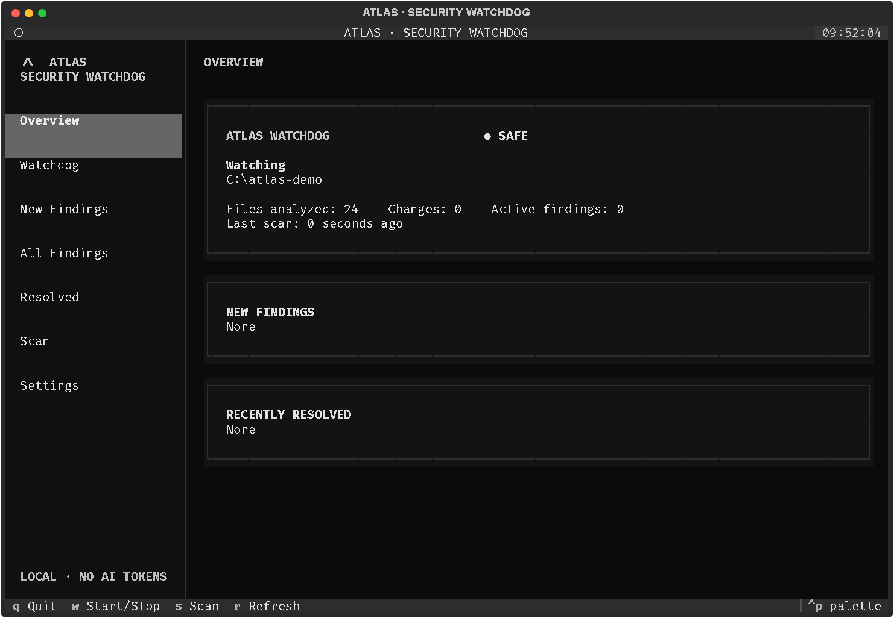

<p align="center">
  
</p>

# ATLAS v0.2.0

[](https://github.com/MarcioConnect/atlas/actions/workflows/ci.yml)
[](https://github.com/MarcioConnect/atlas/actions/workflows/codeql.yml)
[](https://github.com/MarcioConnect/atlas/releases)
[](LICENSE)
[](pyproject.toml)
[](#requirements)

> A defensive terminal agent for Windows.

ATLAS watches the projects you choose, analyzes changed code with local scanners,
and surfaces new risks without depending on Codex, an editor, or AI. It keeps
history and shows when a scan was incomplete.

```powershell
atlas scan "C:\MyProject"        # one-time analysis
atlas watch "C:\MyProject"       # terminal monitoring
atlas monitor start              # monitor saved projects in the background
```

`atlas` opens the panel; `atlas report --format html` generates a report.
Ollama is optional and only analyzes data on request. ATLAS does not exploit
flaws, does not replace Microsoft Defender, and does not guarantee the absence
of vulnerabilities.



## Table of contents

- [About](#about)
- [Quick download (Windows)](#quick-download-windows)
- [Requirements](#requirements)
- [Installation](#installation)
- [Quick start](#quick-start)
- [First run and diagnostics](#first-run-and-diagnostics)
- [Continuous monitoring](#continuous-monitoring)
- [Scanners](#scanners)
- [CI integration](#ci-integration)
- [Suppressing findings](#suppressing-findings)
- [Per-project configuration](#per-project-configuration)
- [Reports](#reports)
- [Watchdog TUI](#watchdog-tui)
- [Supported files](#supported-files)
- [Finding lifecycle](#finding-lifecycle)
- [Privacy and safety](#privacy-and-safety)
- [Limitations](#limitations)
- [Development](#development)
- [Contributing](#contributing)
- [License](#license)

## About

### Reliable results

Each finding shows severity, heuristic confidence, and scanner. `RESOLVED`
requires that the scanner run successfully and re-analyze the file/scope;
otherwise the state is `UNVERIFIED`. Partial scans and missing scanners appear
as coverage gaps. The initial baseline does not surface old alerts as new.

### Release state

The changed file → debounce → local scanner → comparison → SQLite → TUI flow has
been validated on Windows. The current suite passes 2,794 tests in each isolated
environment on Python 3.11 and 3.14. The results and limits are in
[`IMPLEMENTATION_REPORT.md`](IMPLEMENTATION_REPORT.md). There is also a test that
consolidates a burst of 1,000 events into a single scan. Many cases are synthetic
and do not prove accuracy across all projects. External scanners remain optional.

## Quick download (Windows)

Just want to use it? Download the ready-made executable from the release page:

**[Download ATLAS-Security-Agent.exe — v0.2.0](https://github.com/MarcioConnect/atlas/releases/download/v0.2.0/ATLAS-Security-Agent.exe)**

Then, in PowerShell:

```powershell
.\ATLAS-Security-Agent.exe --version
.\ATLAS-Security-Agent.exe monitor start
```

The release includes `ATLAS-Security-Agent.exe.sha256`. Verify that the download
was not corrupted before running it:

```powershell
$expected = (Get-Content .\ATLAS-Security-Agent.exe.sha256).Split(' ')[0]
$actual = (Get-FileHash .\ATLAS-Security-Agent.exe -Algorithm SHA256).Hash.ToLower()
if ($actual -ne $expected) { throw "ATLAS checksum mismatch" }
"ATLAS checksum OK"
```

The v0.2.0 executable is not Authenticode-signed; Windows may show a publisher
warning. A checksum detects corruption but does not by itself prove who published
the file. See [`docs/SIGNING.md`](docs/SIGNING.md).

You do not need to install Python, Git, or open a browser. The logo used by the
executable is available at [`assets/atlas.ico`](assets/atlas.ico).

To install as a Python package and use the `atlas` command, follow the
installation section below.

## Requirements

- Windows 10 or Windows 11
- PowerShell 7 and Windows Terminal recommended
- Python 3.11 or newer
- Administrator privileges are **not** required to scan source code

Optional scanners are detected at runtime. Missing tools never stop the ATLAS
Native scanner or another available scanner.

## Installation

To install from the source ZIP, use **Code > Download ZIP** on GitHub, extract
it, open PowerShell in that folder, and run:

```powershell
py -m pip install .
atlas --version
```

Git is not required. To upgrade a previously installed copy, use
`py -m pip install --upgrade .` from the newly extracted release folder.

If the GitHub release provides `ATLAS-Security-Agent.exe`, Python is not needed
for normal use. Download the executable and run:

```powershell
.\ATLAS-Security-Agent.exe --version
.\ATLAS-Security-Agent.exe monitor start
```

For development:

```powershell
python -m pip install -e ".[dev]"
```

To build the standalone Windows executable with the ATLAS icon and process
identity:

```powershell
.\tools\build_windows.ps1
.\release\ATLAS-Security-Agent.exe monitor start
```

The resident monitor then appears in Task Manager as
`ATLAS-Security-Agent.exe`, with the bundled ATLAS icon instead of `python.exe`.
The one-file Windows build can appear as two grouped ATLAS processes while it
is active: the PyInstaller launcher and the resident agent. Both use the ATLAS
name and icon.

Optional Windows notifications and Python scanners:

```powershell
python -m pip install ".[desktop]"
python -m pip install ".[python-scanners]"
```

The runtime dependency source of truth is `pyproject.toml`.

## Quick start

Run a one-time project scan without opening the monitoring TUI:

```powershell
atlas scan
atlas scan "C:\My Project"
atlas scan "C:\My Project" --format json
```

The command scans the current directory by default. It lists active findings
and warns when optional scanners are missing. Source files over 2 MB are skipped
to bound resource use; they are counted, and the result is marked as partial
coverage rather than implying the project was fully analyzed.

Start continuous monitoring with the interactive view:

```powershell
atlas watch "C:\My Project"
```

For continuous monitoring of every saved project in the background:

```powershell
atlas monitor start
atlas monitor status
```

ATLAS opens a Textual TUI in the current terminal. Keep it running while using
any editor or coding agent. Relevant changes are coalesced with a two-second
debounce, scanned locally, reconciled with SQLite, and displayed as `NEW`,
`EXISTING`, `RESOLVED`, or `UNVERIFIED`. A finding is only marked `RESOLVED`
after its scanner succeeds and rechecks the relevant file/scope. A failed,
partial, unavailable, or timed-out scanner leaves the prior finding unverified.
The scan health indicates `COMPLETE` or `PARTIAL`; scanner installation alone
does not count as a completed analysis.

To monitor every existing project path saved in ATLAS, omit the path or use
`--all`:

```powershell
atlas watch
atlas watch --all
```

The multi-project TUI shows each project's status, scan counters, and new
findings in one screen. If no paths are configured, first run for example:

```powershell
atlas monitor start --watch "C:\My Project"
```

Run one scan without opening the TUI:

```powershell
atlas watch "C:\My Project" --once
```

Enable optional local AI review with Ollama:

```powershell
winget install Ollama.Ollama
ollama pull qwen2.5-coder:3b
atlas watch "C:\My Project" --ai
```

`--ai` only enables the review capability. Scans do not call the model
automatically; select a finding in the TUI and press `A` to explicitly request
a review. ATLAS sends sanitized, short source excerpts exclusively to
`127.0.0.1:11434`, requests structured JSON, exposes no tools to the model, and
never executes model output. Use `--ai-model MODEL` to select another local model.

Use `--silent` to keep the watcher quiet, or persist rule exclusions with
`--ignore-rule`:

```powershell
atlas watch "C:\My Project" --silent
atlas watch "C:\My Project" --notify
atlas watch "C:\My Project" --ignore-rule hardcoded-secret
```

The Watchdog uses an in-memory file snapshot to prioritize changed files and
lines after the first observation. The native scanner rechecks each changed
file in full so an unchanged finding is not falsely marked resolved. Optional
scanners remain scoped to changed files; unavailable or failed scanners are
reported without stopping the watch. A `LISTEN` port is an observation, not
proof of external reachability. The Defender integration is read-only during
normal scans and its visibility depends on Windows policy and permissions.
When `winotify` is installed, new findings also generate a Windows desktop
notification; otherwise the TUI remains the source of truth.

## First run and diagnostics

On a fresh install, ATLAS can find your Git repositories, choose what to watch,
run a first scan, and optionally register the background monitor in one step:

```powershell
atlas init
atlas init --path "C:\My Project" --yes --no-scan
```

When something does not work, run `atlas doctor` to check Python, optional
scanners, local Ollama, the resident monitor, the Windows login task, and the
local database. Failures are listed with a suggested fix; `atlas doctor --no-fix`
only reports without prompting.

The resident monitor writes a redacted log to
`%LOCALAPPDATA%\ATLAS\logs\monitor.log` (rotated once to `monitor.log.old`).
Inspect it with:

```powershell
atlas monitor logs
atlas monitor logs --limit 200 --follow
```

## Continuous monitoring

`atlas monitor start` runs in the background and starts one local code Watchdog
per existing configured path. All non-ignored file changes are recorded as
sanitized metadata; supported source/configuration files are debounced, scanned
locally, and reconciled as `NEW`/`EXISTING`/`RESOLVED`. AI remains opt-in with
`atlas watch --ai`. Use `atlas monitor status` and `atlas monitor events` to
inspect the resident service.

## Scanners

| Scanner | Scope | Optional install |
|---|---|---|
| ATLAS Native | Secrets, risky APIs, exposed binds, Docker basics | Built in |
| ATLAS Security Guard | Prompt injection, exfiltration chains, obfuscation, tool abuse | Built in |
| Microsoft Defender | Malware/spyware state and detection history on Windows | Built into Windows |
| Executable inspection | Streaming SHA-256 and Authenticode status; unsigned is not proof of malware | Built into Windows |
| YARA | Optional scanning with selected local rules and bounded runtime | `py -m pip install 'atlas-security-agent[yara]'` |
| Ollama AI | Explicit review of a selected, sanitized finding or user-requested chat context | `winget install Ollama.Ollama` |
| Semgrep | Multi-language static analysis | `python -m pip install semgrep` |
| Bandit | Python security linting | `python -m pip install bandit` |
| pip-audit | Python dependencies | `python -m pip install pip-audit` |
| npm audit | npm dependencies | Install Node.js/npm |
| PSScriptAnalyzer | PowerShell analysis | `Install-Module PSScriptAnalyzer -Scope CurrentUser` |
| Trivy | Dependencies, containers, misconfigurations, secrets | `winget install AquaSecurity.Trivy` |

Some dependency scanners may need network access to refresh advisory databases.
This does not involve an LLM or AI tokens.

## CI integration

`atlas scan --fail-on` returns exit code `2` when a finding meets the severity
threshold, so it can gate a pipeline:

```powershell
atlas scan . --fail-on HIGH
atlas scan . --fail-on HIGH --format json
```

For GitHub code scanning, generate SARIF and upload it:

```powershell
atlas report --format sarif --project . --output .\reports
```

Install a Git `pre-commit` hook that blocks commits with findings at or above a
threshold:

```powershell
atlas install-hook --project .
atlas install-hook --fail-on MEDIUM --force
```

Remove `.git/hooks/pre-commit` to disable the hook.

## Suppressing findings

Accepted-risk findings can be suppressed from the CLI or directly in the TUI. A
suppression records the fingerprint, a redacted reason, and an expiry.

```powershell
atlas config --suppress-rule python-eval --file app.py --days 30 --reason "reviewed"
atlas config --list-suppressions
```

In the Watchdog TUI, select a finding and press `X` to open the suppression
dialog (reason required). Suppressed findings no longer fail a build and are
excluded from new alerts.

## Per-project configuration

A repository can tune the scanner without touching the global settings by
adding a `.atlas.toml` file at its root:

```toml
[scan]
ignored_rules = ["python-eval", "B602"]
risk_overrides = { B602 = "LOW" }
```

Project overrides are merged with the user settings and applied to every scan
(CLI and Watchdog). Invalid files are ignored, never fatal.

## Reports

Use **4. Generate Report** in the launcher (or activate it with the keyboard)
to write a local Markdown report containing the latest system Security Score,
Watchdog findings, scanner status, evidence, risk, recommendations, and the
sanitized file-change history for each known project. Without `--project`, the
report consolidates all configured and previously scanned projects. The
file is saved in your Windows Downloads folder as
`atlas-report-YYYY-MM-DD.md`; an existing report is never overwritten and a
time suffix is used when necessary. All report fields are sanitized and
sensitive values are replaced with `[REDACTED]`.

Reports can also be generated directly from the CLI:

```powershell
atlas report --format md
atlas report --format html
atlas report --format json
atlas report --format sarif
atlas report --project "C:\My Project" --output "C:\Reports"
```

## Watchdog TUI

Views: Overview, Watchdog, New Findings, All Findings, Resolved, Scan, and
Settings.

Keyboard shortcuts:

- `W`: start or stop watching
- `S`: run a full manual scan
- `Enter`: open details for the selected finding
- `A`: request a local AI review of the selected finding when started with `--ai`
- `R`: refresh
- `Q`: quit

## Supported files

ATLAS records create, modify, move, and delete events for every non-ignored
file. Security scans prioritize `.html`, `.py`, `.js`, `.ts`, `.tsx`, `.jsx`,
`.ps1`, `.bat`, `.json`, `.yaml`, `.yml`, `Dockerfile`, and Compose files.
File contents are never stored in the activity history.

It ignores VCS metadata, `node_modules`, virtual environments, `site-packages`,
Python caches, test/build artifacts, `dist`, and `build`.

## Finding lifecycle

A stable SHA-256 fingerprint uses scanner, rule, normalized project-relative
file path, and a sanitized source-context identity. It survives unrelated line
insertions without storing source or secret values. The initial Watch baseline
is accepted as EXISTING, so only later regressions become NEW. On every scan:

- `NEW`: not active in the previous measured state, or it reappeared;
- `EXISTING`: still present;
- `RESOLVED`: absent from a scanner/file scope that was successfully measured.
- `UNVERIFIED`: the responsible scanner failed, was skipped, or could not confirm coverage.

An unavailable scanner has no coverage and therefore cannot accidentally mark
its older findings as resolved.

Confidence is a rule/context heuristic for triage, not a calibrated probability.
Missing scanners and eligible source files over 2 MB are shown as coverage gaps;
they are never described as cleanly analyzed.
Incremental Watchdog results explicitly cover only changed files and are not
reported as a complete project scan. The initial baseline is accepted once per
project; subsequent Watchdog starts still report newly discovered findings.

## Privacy and safety

ATLAS is read-only by default and never exploits vulnerabilities. Evidence is
sanitized before display or storage. Passwords, tokens, API keys, cookies,
connection strings, private keys, `.env` values, and common credential formats
are replaced with `[REDACTED]` or omitted entirely.

Security Guard uses heuristic patterns on supported scanned source files to flag
possible prompt injection, exfiltration and encoded instruction sequences.
It is not a semantic security guarantee or a global interceptor for browsers,
emails, tools or other agents. The Ollama reviewer receives source as untrusted
data and has no execution tools; prompt instructions alone cannot guarantee that
a model will ignore every injection. Results still require human review.

For ordinary file activity, ATLAS stores only sanitized metadata: timestamp,
event type, severity, and path. It does not store file contents. Sensitive
filenames are replaced with `[SENSITIVE_FILE]`.

## Limitations

- Windows is the primary supported platform; other systems are best effort.
- Optional scanner accuracy and coverage depend on installed versions and rules.
- Semgrep `auto` configuration and vulnerability databases can require network access.
- Protected machine-wide checks may be incomplete without Administrator access;
  ATLAS reports reduced coverage rather than failing.
- `atlas agent` opens the integrated panel. `--advanced` remains as a compatibility
  alias. Chat uses Ollama when available, otherwise local rules.
- The native scanner is intentionally conservative and is not a replacement for
  specialist scanners or a professional security review.
- Ollama improves context but can still make mistakes; deterministic scanners
  remain authoritative and AI review is clearly labelled.
- ATLAS complements Microsoft Defender. It is not an antivirus engine and cannot
  guarantee detection of every malware, spyware, rootkit or zero-day attack.
- Defender telemetry can require Administrator access under corporate policy;
  ATLAS reports this limitation instead of bypassing it.

## Development

```powershell
python -m pytest -q
atlas --version
atlas watch . --once
.\tools\build_windows.ps1
.\release\ATLAS-Security-Agent.exe --version
```

See [CHANGELOG.md](CHANGELOG.md) for release notes. Contribution details are in
[CONTRIBUTING.md](CONTRIBUTING.md) and the code of conduct in
[CODE_OF_CONDUCT.md](CODE_OF_CONDUCT.md).

## Contributing

Contributions are welcome. Read [CONTRIBUTING.md](CONTRIBUTING.md) for the
development workflow and [CODE_OF_CONDUCT.md](CODE_OF_CONDUCT.md) for the
community rules. To report a vulnerability, use a private GitHub Security
Advisory as described in [SECURITY.md](SECURITY.md).

## License

Distributed under the MIT License. See [LICENSE](LICENSE) for details.
